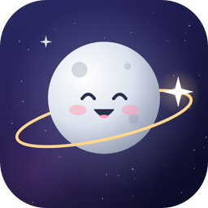
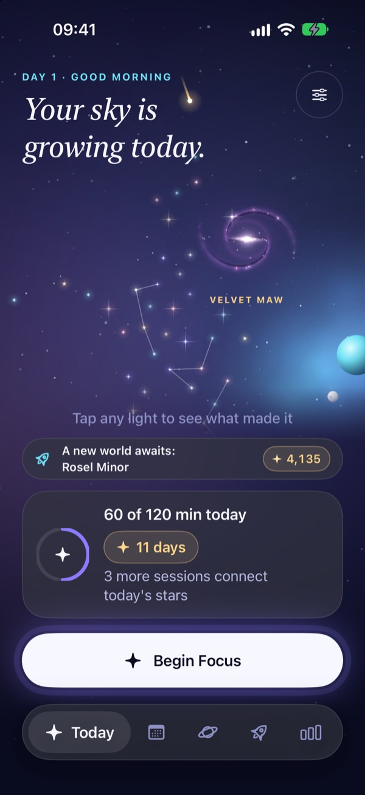
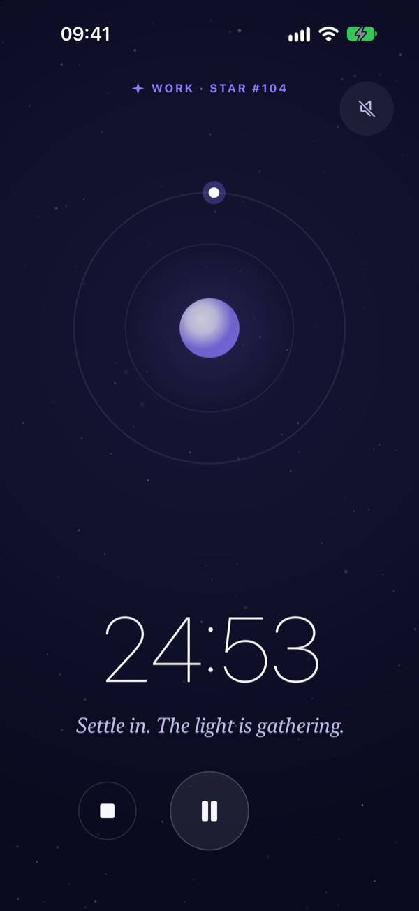
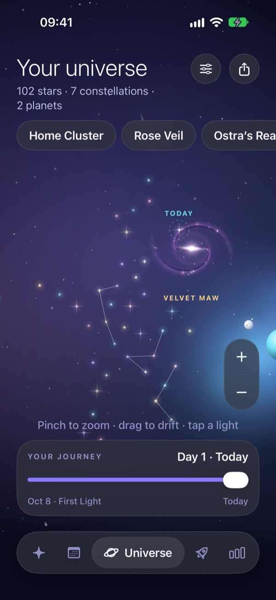
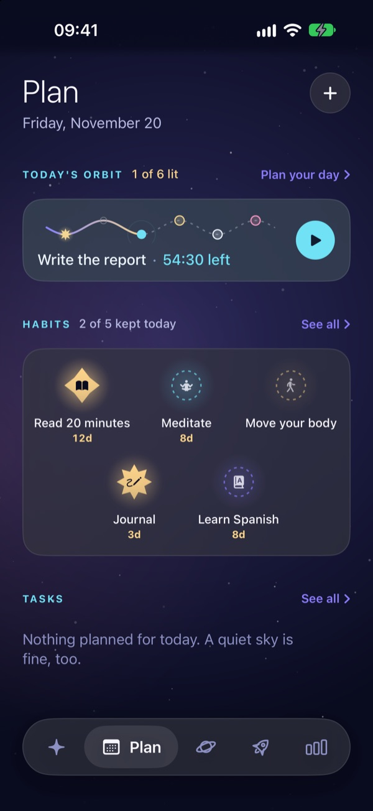
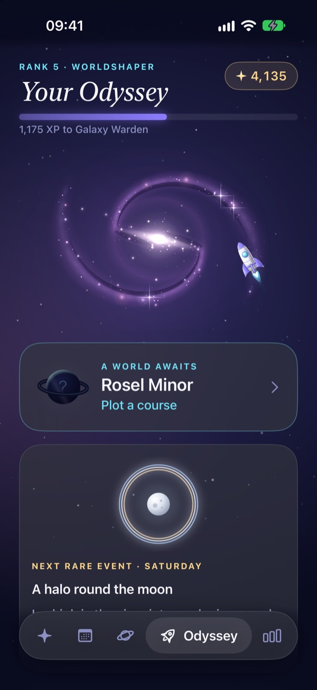
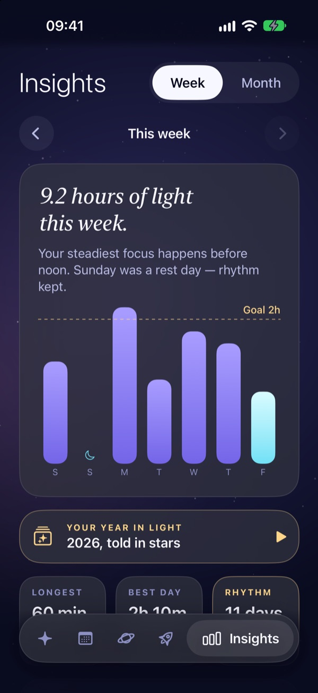

<p align="center">
  
</p>

<h1 align="center">Orbi</h1>

<p align="center">
  <b>Your focus, your universe.</b><br>
  A focus timer for iPhone and iPad where every session lights a star in a universe of your own.
</p>

<p align="center">
  <a href="https://github.com/basoglufurkan/Orbi/actions/workflows/ci.yml"></a>
  
  
  
  <a href="LICENSE"></a>
</p>

<p align="center">
  
  
  
</p>
<p align="center">
  
  
  
</p>

Orbi is a Pomodoro timer with a long memory. Every completed focus session
becomes a permanent star. Four in a day join into a constellation, and as the
hours add up the sky grows planets, moons, nebulae and comets. The universe,
its worlds and its sounds are all drawn and synthesized in code.

## Features

- **Focus that adds up.** Sessions with an intention and a category, short
  and long breaks, and ambient soundscapes. Ending early still earns a smaller
  star after five minutes, and nothing earned is ever taken away.
- **A universe to explore.** Pan, pinch and fly through your sky with gyro
  parallax, tap any light to see the session that made it, and share it as a
  card.
- **The Odyssey.** Focus earns stardust and powers a rocket to procedurally
  generated worlds that you land on and terraform. It's a game layer where
  nothing can be lost, duplicated or bought.
- **Plan.** An hour-by-hour day plan you follow as a route through space,
  habits drawn as stars that brighten with every day kept, and tasks with
  session estimates.
- **Insights.** Weekly and monthly rhythm, a Year in review, and a Collection
  of cosmic artifacts.
- **Focus together.** Up to eight friends share one galaxy while they focus,
  over CloudKit, with no server.
- **Everywhere in the system.** Home Screen, Lock Screen and StandBy widgets,
  a Live Activity and the Dynamic Island, Siri and Shortcuts, Focus filters, a
  Control Center control, AlarmKit alarms, an Apple Watch app, and an
  optional Screen Time shield.
- **Private by default.** No account needed (Sign in with Apple is optional).
  iCloud sync goes through your own private database, analytics carry no ad
  identifiers, and nothing you type ever leaves the device.
- **For everyone.** Dynamic Type up to AX5, VoiceOver, Reduce Motion and
  Increase Contrast, in 13 languages including Arabic, right to left.

Orbi is free. Orbi+ adds sky themes, soundscapes, ship finishes and older
history; the stars, the universe, the Odyssey and focusing together stay free.

## Built with

| Area | Technologies |
| --- | --- |
| UI and drawing | SwiftUI, Observation, `Canvas` + `TimelineView`, Swift Charts, RealityKit, Core Motion |
| Data and sync | SwiftData with a versioned schema, CloudKit (private sync, public rooms) |
| System | WidgetKit, ActivityKit, App Intents, AlarmKit, FamilyControls, WatchConnectivity |
| Sound and haptics | AVAudioEngine with procedural synthesis, Core Haptics |
| Services | [RevenueCat](https://www.revenuecat.com) for Orbi+, [Firebase Analytics](https://firebase.google.com/products/analytics) (optional) |
| Tests | Swift Testing, XCTest UI tests, GitHub Actions |

There are no other third-party libraries, no image assets for the sky and no
audio files.

## Getting started

You need Xcode 26.1 or later (the project is built with Xcode 27.2).

```bash
git clone https://github.com/basoglufurkan/Orbi.git
cd Orbi
open Lumora.xcodeproj
```

Choose the **Lumora** scheme and an iPhone simulator, then Run. The simulator
needs no signing setup and no keys; Swift Package Manager fetches RevenueCat
and Firebase on the first build.

Two services stay off until you add your own keys, which are kept out of git:

| Service | Add | Without it |
| --- | --- | --- |
| Orbi+ purchases | `Config/Secrets.xcconfig`, copied from `Config/Secrets.example.xcconfig` | Purchases are off; debug builds show sample prices |
| Analytics | `Lumora/Resources/GoogleService-Info.plist` | Nothing is sent |

To run on your own device, change the team, bundle identifiers, App Group and
iCloud container as described in
[Running on a device](docs/DEVELOPMENT.md#running-on-a-device).

**See it with data.** Add these launch arguments to the scheme (**Product ›
Scheme › Edit Scheme › Run › Arguments**) for a sky with months of history, a
day plan and habits:

```
-lumora-skip-onboarding -lumora-demo 130 -lumora-demo-plan -lumora-demo-habits
```

`-lumora-time-scale 300` turns a 25-minute session into five seconds. Every
debug tool is listed in [docs/DEVELOPMENT.md](docs/DEVELOPMENT.md#debug-and-preview-tools).

## Tests

```bash
xcodebuild test -project Lumora.xcodeproj -scheme Lumora \
  -destination 'platform=iOS Simulator,name=iPhone 17' \
  -only-testing:LumoraTests
```

The unit tests cover the timer's state machine, exactly-once rewards, the
deterministic universe, time zones and calendars, the day plan, habits, deep
links and App Intents. UI tests walk the main flows end to end; run them with
`-only-testing:LumoraUITests -testLanguage en -testRegion US`. See
[docs/TESTING.md](docs/TESTING.md).

## Project structure

```
Lumora/           The app: App, Features, Services, Core (design system),
                  Models, Animations, Intents, Resources
Shared/           Code shared with the extensions: deep links, the widget
                  snapshot, the day plan timeline, habit schedules
LumoraWidgets/    Widgets, the Control Center control and the Live Activity
LumoraWatch/      The Apple Watch app
LumoraShield*/    Screen Time shield extensions
LumoraTests/      Unit and integration tests (Swift Testing)
LumoraUITests/    UI tests (XCTest)
Config/           Info.plists, entitlements and build settings
docs/             Architecture, features, analytics, development and testing
```

Views read one `@Observable` `AppModel`, which owns the services; services own
their SwiftData writes; and the engines (timer, progression, layout, planners,
insights) are pure functions that most tests exercise directly.

## Documentation

- [Architecture](docs/ARCHITECTURE.md): the layout, the key decisions, iCloud
  sync and links
- [Features](docs/FEATURES.md): rewards, Siri and Shortcuts, tasks, the day
  plan, habits, the Odyssey, Focus together and Orbi+
- [Analytics and privacy](docs/ANALYTICS.md): what is measured, and what never
  leaves the device
- [Development](docs/DEVELOPMENT.md): configuration, devices, debug tools,
  localization and scripts
- [Testing](docs/TESTING.md): running the suites and what they cover

## About the name

Orbi was built under the codename *Lumora*. The Xcode project, targets,
folders, the `lumora://` URL scheme and the debug flags keep that name.

## Contributing

Bug reports and pull requests are welcome. Please read
[CONTRIBUTING.md](CONTRIBUTING.md) first; everyone taking part is expected to
follow the [Code of Conduct](CODE_OF_CONDUCT.md). To report a security issue,
see [SECURITY.md](SECURITY.md).

## License

Orbi is released under the [MIT License](LICENSE).

The name Orbi, the app icon and Pell are the app's identity rather than its
code. If you ship your own app built from this one, please give it its own
name and look.
